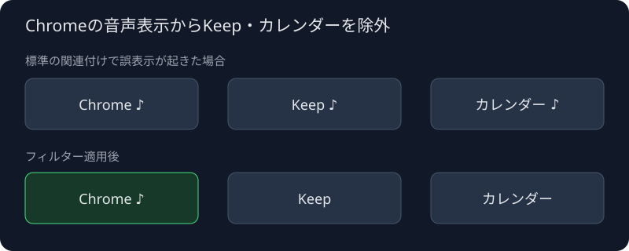

# タスクバーの音声表示フィルター

Google KeepとGoogleカレンダーが、通常のChromeの音声インジケーターを引き継いで表示する問題を避ける、個人用のPlasmaウィジェットです。



図は動作の模式図です。Chromeの音声マークを残し、Keepとカレンダーでは常に非表示にします。この2つのアプリ自身が通知音などを出しても、タスクバー上の音声マークは出ません。音声再生や通知そのものは停止しません。

## 使い方

このフォルダーで実行します。Pythonパッケージの追加は不要です。

```sh
/usr/bin/python3 manage.py install
/usr/bin/python3 manage.py status
```

標準の「アイコンだけのタスクマネージャ」に戻す場合：

```sh
/usr/bin/python3 manage.py restore
```

現在のピン留め、ウィジェット設定、パネル内の位置を引き継ぎます。新しいウィジェットが読み込みを完了したことを確認してから、元のウィジェットを外します。切り替えにPlasmaの再起動は不要です。システムのプラグインやChromeの設定は書き換えません。

インストール先は`~/.local/share/plasma/plasmoids/org.novelsavage.plasma.taskaudiofilter/`、切り替え前のバックアップは`~/.local/state/plasma-audio-filter/`です。`XDG_DATA_HOME`と`XDG_STATE_HOME`を指定している環境では、その場所を使用します。

## 実装

ベースは[KDE plasma-desktop v6.6.6のtaskmanager](https://github.com/KDE/plasma-desktop/tree/v6.6.6/applets/taskmanager)です。元のファイルの著作権・SPDX表記を維持しています。

- `contents/ui/code/AudioFilter.js`で2つのChromeアプリIDを判定します。
- `Task.qml`は除外対象の音声ストリームを空にし、表示と音声ミュートの関連付けを抑えます。アプリIDが遅れて確定した場合にも再評価します。
- アプリ名・ウィンドウのタイトルに依存せず、Chromeの32文字のアプリIDで判定します。`crx_...`形式と、プロファイル名を含むdesktop ID形式を扱います。
- アイコン専用モードを固定し、翻訳は元のタスクマネージャのドメインを明示します。
- 既存のC++バックエンドをロードするため、`X-Plasma-RootPath`に`org.kde.plasma.taskmanager.so`を指定しています。`.so`を含む名前で既存プラグインを読み込み、独自IDのパッケージ内QMLを使う方式です。[libplasmaのプラグインローダー](https://github.com/KDE/libplasma/blob/v6.6.6/src/plasma/pluginloader.cpp)と[AppletのQML探索処理](https://github.com/KDE/libplasma/blob/v6.6.6/src/plasma/applet.cpp)に依存します。
- `manage.py`はパネルのスクリプトAPIで追加・削除します。Plasma 6.6.6では`Widget.index`の読み書きが実装されていないため、`AppletOrder`で順番を確認し、元の座標を指定して追加します。設定の取得ではXMLスキーマの型を指定し、StringList・Bool・Intを文字列に変換しません。切り替えは実際のTasksModelが元のランチャー一覧を読み込んだことまで照合し、失敗時は元のウィジェットを残します。

0.2.0は旧版とは別のウィジェットIDを使います。旧版のQMLキャッシュを引き継がず、新しい表示コードを読み込むためです。初期設定はインストール先だけに生成する`InitialSettings.qml`から、QMLの設定マップへ型を保って反映します。適用済みの印を保存するため、ログインし直したときにピン留めを上書きしません。個人の設定値はリポジトリのテンプレートには含めません。

## 対応範囲

Kubuntu / Plasma **6.6.6**で検証しました。バージョン違いでの新規インストールはスクリプトが止めます。インストール済みのウィジェットは更新後も残るため、Plasma更新時には上流QML・内部APIとの互換性確認が必要です。更新後に問題が出た場合は`restore`で標準版へ戻せます。

Chromeの個別タブ・個別ウィンドウの音源を判別するものではありません。通常のChromeのウィンドウ間で表示が共有される問題には、標準版と同じ制約があります。

## 検証

デスクトップを起動しない基本テスト：

```sh
/usr/bin/python3 -m unittest discover -s tests -p 'test_*.py' -v
```

隔離GUIテスト：

```sh
/usr/bin/python3 tests/gui_test.py
```

`bubblewrap`の独立したPID・マウント・ネットワーク・ユーザー名前空間の中で、専用D-Busと仮想画面のKWinを起動します。普段のホーム、`/run`の通知・セッション用ソケット、ホストのプロセスには接続しません。初回起動のウェルカム画面もテスト内では起動しません。`bubblewrap`が利用できなければテストを停止し、ホスト環境へフォールバックしません。

依存パッケージは`bubblewrap`、KWin/Plasma、`python3-pyqt6`、`python3-dbus`です。Pythonの追加パッケージは不要です。

- QtのJavaScriptエンジンで、対象ID・対象外・空文字・誤った部分一致を確認。
- 実際のPlasmaタスク表示に、3つの検証用ウィンドウを表示。共有音声を模したテスト用モデルを使い、Chromeの音声マークが見え、Keep・カレンダーの音声マークが見えないことを確認。
- 18件のピン留め（カンマ入りのdesktop IDを含む）、Bool・Intの設定、パネル内の順番を、インストール・復元後に確認。切り替え時の実際のTasksModelのランチャー一覧も照合。

GUIテストの音声データは合成データです。Chromeでの音声再生から表示までを通した自動テストではありません。テスト用の音声モデルやログ出力コードは、インストール用パッケージには含めていません。検証結果とローカルログは`tests/artifacts/`に出力します。これらはGit管理から除外します。

## 0.2.0で修正した問題

初版では、設定のコピーを文字列として取得していたため、複数のピン留めがランチャー一覧へ正しく渡らない場合がありました。保存ファイルの一致だけでは検出できなかったため、型を保つコピーと、実際の表示モデルの一覧を検証する処理を追加しました。

また、初版のGUIテストはD-BusとXDGディレクトリだけを分離していました。初回起動サービスからのクラッシュ通知が普段のセッションへ届いたため、テストはbubblewrapによる隔離が必須になりました。

## ライセンス

上流のタスクマネージャQMLと派生コードはGPL-2.0-or-laterです。個々の上流ファイルにある表記も参照してください。
